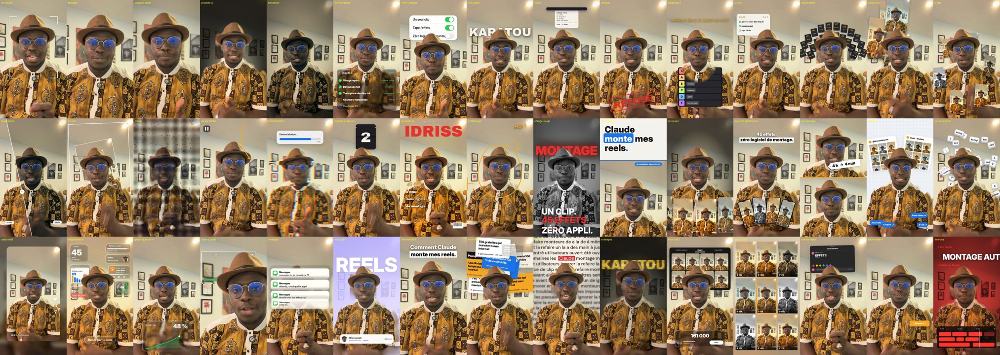

# Skill Claude : 45 effets vidéo en français

**Un seul clip. 45 effets. Zéro logiciel de montage.**

Un skill pour Claude qui ajoute des effets de montage à tes vidéos face caméra : orbite de reels autour de ta tête, projecteur, widgets en verre liquide, timeline de montage, commentaire Instagram, mot géant derrière toi, sous-titres mot par mot... Tu tapes `/effets orbite` dans Claude, tu donnes ta vidéo, et c'est fait.

Les effets repèrent ton visage et te détourent image par image, pour que le texte et les images passent **derrière ta tête**.

Par Idriss Laouali, co-fondateur de [Karatou Academy](https://karatou.academy). L'IA appliquée aux défis du monde réel.

**Le guide complet, avec chaque effet en image : https://karatou.academy/blog/skill-claude-effets-video**



## Installer

Dans Claude Code (ou Cowork), colle :

```
git clone https://github.com/idrissLaouali/skill-claude-effets-video ~/.claude/skills/effets
```

Puis dans Claude : `/effets` et glisse ta vidéo. La première fois, Claude installe tout seul ce qu'il faut (Python, ffmpeg, 1 à 3 minutes).

Sans Claude, à la main :

```
bash scripts/installer.sh
.venv/bin/python scripts/effets.py --liste
.venv/bin/python scripts/effets.py orbite ma_video.mp4 resultat.mp4 --debut 2 --fin 5
```

## Comment ça marche

1. **Repérage** : chaque image est analysée en 540 px. YuNet trouve ton visage, MediaPipe Selfie Segmenter te détoure. Le suivi est lissé dans les deux sens, donc sans retard.
2. **Effets** : chaque image est recomposée en 1080p (ou 4K) avec les calques devant ou derrière toi, puis envoyée à ffmpeg. Le son d'origine est gardé.
3. **Plan** : un petit fichier JSON dit quel effet, quand, avec quel texte. Claude l'écrit pour toi.

```json
{"effets": [
  {"effet": "verrouille", "debut": 0.0, "fin": 1.8, "texte": "IDRISS"},
  {"effet": "orbite", "debut": 2.0, "fin": 4.5},
  {"effet": "mot-geant", "debut": 5.0, "fin": 7.0, "texte": "KARATOU"}
]}
```

## Les 45 effets (+ sous-titres en bonus)

La liste complète, avec les options, est dans [SKILL.md](SKILL.md). Chaque effet a un nom français et répond aussi à son nom anglais.

| Famille | Effets |
|---|---|
| Caméra et lumière | verrouille, plongee, poussee-lente, projecteur, ambiance, avant-apres, tunnel, points, pause-fleche, desinstallation, cadre-reel |
| Verre liquide | widgets-verre, graphique-verre, zoom-epaule, messages, taches-claude, interrupteurs |
| Mots et titres | mot-geant, ticket, tampon, compte-a-rebours, couverture, griffonnage, collage-rouge, titre-partage, mot-pastel, titre-encadre, mur-titres, raccord, enseigne, classement, a-faire, alignement |
| Tes reels | avalanche, orbite, carrousel, eventail-telephones, broll-partage, pastilles, pluie-touches, mur-profil, grille-profil |
| Interface | commentaire, abonnement, timeline |
| Bonus | sous-titres (mot par mot, en français, avec `scripts/transcrire.py`) |

## Ce qu'il y a dedans

```
SKILL.md              les consignes pour Claude (en français)
scripts/effets.py     le moteur : python effets.py --liste
scripts/transcrire.py transcription mot par mot (faster-whisper)
scripts/installer.sh  installation en une commande
scripts/studio/       les effets, rangés par famille
models/               YuNet (MIT) et Selfie Segmenter (Apache 2.0)
polices/              polices libres (OFL / Apache)
```

## Crédits

Inspiré de [claude-video-effects](https://github.com/Vibha-Ramprakash/claude-video-effects) de Vibha Ramprakash (MIT) : même idée et mêmes modèles, code réécrit, en français et aux couleurs de Karatou.

Licence MIT. Ce sont des versions de départ : regarde toujours le résultat avant de publier.
